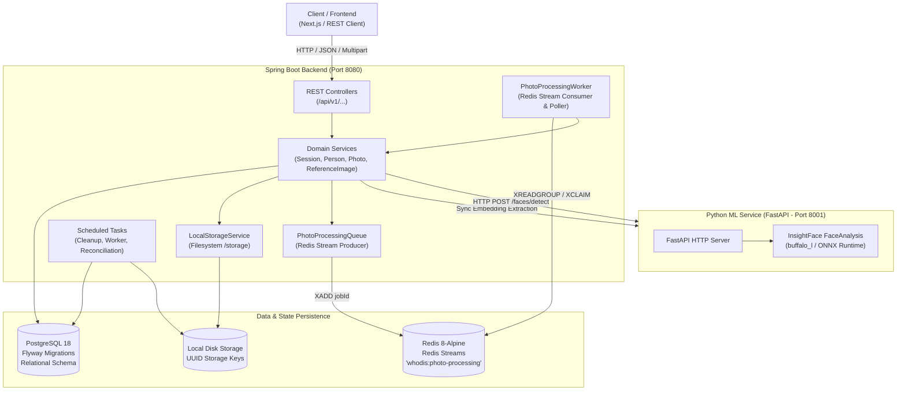
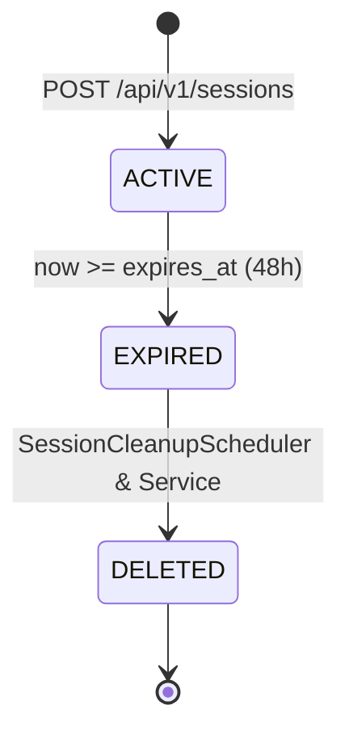

# System Architecture

WhoDis is an AI-powered group photo organizer that identifies people appearing in photos and organizes them accordingly. Users create temporary, privacy-conscious sessions, register participants with reference portrait photos, upload collections of group photos, and rely on an asynchronous computer vision pipeline to detect faces and match them to registered individuals. A single photo can be associated with multiple registered people, while unrecognized faces are preserved for manual inspection and assignment.

---

## 1. High-Level Architecture

WhoDis is architected as a distributed system composed of independent services communicating over synchronous HTTP/REST APIs and asynchronous Redis Streams:



---

## 2. Technology Stack

### Backend Service
- **Runtime & Language:** Java 25
- **Framework:** Spring Boot 4.1.1 (Maven parent `spring-boot-starter-parent:4.1.1`)
- **Web MVC:** Spring Web MVC (`spring-boot-starter-webmvc`)
- **Data & ORM:** Spring Data JPA with Hibernate (`spring-boot-starter-data-jpa`)
- **Database Migrations:** Flyway (`org.flywaydb:flyway-database-postgresql`, `spring-boot-starter-flyway`)
- **Validation:** Jakarta Bean Validation (`spring-boot-starter-validation`)
- **Cache & Messaging:** Spring Data Redis (`spring-boot-starter-data-redis:4.1.2`)
- **MIME & Image Validation:** Apache Tika Core 4.0.0, TwelveMonkeys ImageIO WebP 3.15.2
- **Observability:** Spring Boot Actuator (`spring-boot-starter-actuator`)

### Machine Learning Service
- **Runtime & Language:** Python >= 3.14 (managed by `uv`)
- **Web Framework:** FastAPI >= 0.141.1, Uvicorn >= 0.54.0, python-multipart >= 0.0.32
- **Data Models & Settings:** Pydantic >= 2.13.5, Pydantic-Settings >= 2.15.0
- **Computer Vision & Face Recognition:** InsightFace >= 2.0 (`buffalo_l` model pack)
- **Inference Engine:** ONNX Runtime (`onnxruntime-gpu==1.30.0` or CPU fallback)
- **Image Processing:** OpenCV (`opencv-python` / `cv2`), NumPy

### Data & Infrastructure
- **Relational Database:** PostgreSQL 18 (`postgres:18`)
- **Message Broker / Stream Engine:** Redis 8 Alpine (`redis:8-alpine`, append-only persistence)
- **Object / File Storage:** Local filesystem storage abstraction (`LocalStorageService`)

---

## 3. Service Responsibilities & Component Interaction

### Frontend (Client Layer)
- Serves the user interface for session creation, person registration, photo uploads, job progress tracking, and face assignment.
- Interacts exclusively with the Spring Boot backend via HTTP/REST at `/api/v1/...`.

### Spring Boot Backend (Core Orchestrator)
- Manages the lifecycle of temporary sessions, participant entities, and uploaded photos.
- Enforces strict image validation (MIME detection via Tika, dimension and pixel limits via ImageIO).
- Stores raw images safely onto disk with UUID filenames to prevent path traversal.
- Manages reference images synchronously: immediately calls the ML service to extract 512-dimensional face embeddings and persists them as raw little-endian IEEE 754 floats (`BYTEA`) in PostgreSQL.
- Coordinates asynchronous processing for group photos: stores the photo, creates a `ProcessingJob`, publishes the job ID to Redis Streams, and processes detected faces against registered reference embeddings.
- Executes automated background maintenance: session expiration cleanup, pending message reclamation, and queue reconciliation.

### PostgreSQL (Persistence Layer)
- Houses all relational entities: `sessions`, `people`, `reference_images`, `reference_embeddings`, `photos`, `processing_jobs`, and `photo_faces`.
- Enforces relational integrity via foreign key cascades and check constraints.
- Employs pessimistic locking (`SELECT ... FOR UPDATE`) during job claiming, session cleanup, and photo deletion to prevent race conditions.

### Redis (Queue & Stream Broker)
- Implements reliable job queuing using Redis Streams under the stream key `whodis:photo-processing`.
- Uses consumer groups (`whodis:photo-processing:workers`) and dedicated consumer instances (`whodis-worker-1`).
- Provides message recovery via Redis Pending Entries List (PEL) inspection (`XPENDING` and `XCLAIM`).

### Python ML Service (Inference Worker)
- Stateless FastAPI service running the InsightFace `buffalo_l` model suite.
- Exposes endpoints to:
  1. Extract a single normalized 512-dimensional embedding from a reference photo (`POST /internal/v1/embeddings/reference`).
  2. Detect all faces, bounding boxes, detection confidence scores, and embeddings from a group photo (`POST /internal/v1/faces/detect`).

---

## 4. Communication Protocols

| Source | Destination | Protocol / Transport | Payload Format | Description |
|---|---|---|---|---|
| Client | Backend | HTTP/1.1 or HTTP/2 | JSON / Multipart Form | REST API calls for sessions, photos, and face assignments |
| Backend | PostgreSQL | JDBC (PostgreSQL Driver) | SQL (TCP port 5432) | Relational queries, transactions, and row-level locking |
| Backend | Redis | Redis Serialization Protocol (RESP) | Binary / Text (port 6379) | Stream `XADD`, `XREADGROUP`, `XACK`, `XPENDING`, `XCLAIM` |
| Backend | ML Service | HTTP/1.1 (`RestClient`) | Multipart Form / JSON (port 8001) | Synchronous image transmission for feature extraction |
| Backend | Local Disk | POSIX Filesystem Calls | Binary Image Bytes | Secure image reads/writes at configured storage root |

---

## 5. Architectural Patterns & Design Decisions

### 1. Dual Execution Model: Synchronous Reference vs. Asynchronous Photo Processing
- **Reference Images:** Uploading a reference image requires validating that *exactly one face* is present. The backend invokes the ML service synchronously during the upload request. If 0 or >1 faces are detected, the request fails immediately (HTTP 422/400), ensuring reference datasets are always pristine.
- **Group Photos:** Batch photo uploads contain multiple images with unknown face counts. Uploading persists files, creates `ProcessingJob` rows in `PENDING` state, registers database commits, and publishes job IDs to Redis Streams. Processing occurs asynchronously in the background.

### 2. Transaction-Synchronized Queue Publishing
To guarantee that Redis never processes a job before the database transaction has committed, queue publishing is deferred using Spring's `TransactionSynchronizationManager.registerSynchronization` inside `afterCommit()`. If the database rollback occurs, no Redis message is published.

### 3. Outbox Reconciliation Pattern
If Redis is temporarily unreachable during `afterCommit()`, the job remains in PostgreSQL with `queue_published_at = NULL`. The scheduled `PhotoQueueReconciliationService` continuously polls for unpublished pending jobs and republishes them.

### 4. Pessimistic Row Locking for Concurrency
To avoid distributed locks, the system relies on PostgreSQL row-level locks (`SELECT ... FOR UPDATE`):
- `PhotoRepository.findByIdForUpdate` prevents simultaneous deletion while processing or vice-versa.
- `SessionRepository.findByIdForUpdate` coordinates session cleanup with ongoing operations.

### 5. Binary Serialization for Face Embeddings
Face embeddings are 512-dimensional `float32` vectors. Instead of storing 512 JSON numbers or requiring vector extensions (like `pgvector`), the system serializes vectors into binary byte arrays using little-endian byte ordering (`ByteBuffer.order(ByteOrder.LITTLE_ENDIAN)`). This requires exactly 2,048 bytes per embedding in PostgreSQL `BYTEA` columns, minimizing database storage overhead and serialization latency. Vector similarity is calculated in-memory in the backend using cosine similarity.

---

## 6. Session-Based Lifecycle & Data Ownership

WhoDis is built around temporary sessions without requiring persistent user accounts:



- **Session Creation:** A session is created with `status = ACTIVE`, an initial timestamp, and an expiration timestamp (default: 48 hours).
- **Session Hierarchy & Scoping:**
  - All entities (`Person`, `ReferenceImage`, `Photo`, `ProcessingJob`, `PhotoFace`) are strictly scoped to a `Session`.
  - Every API endpoint validates that the target resource belongs to the session specified in the URL path.
- **Session Expiration:**
  - When `Instant.now() >= expiresAt`, domain operations throw `SessionExpiredException` (mapped to HTTP 410 Gone).
- **Cascading Deletion & Cleanup:**
  - `SessionCleanupScheduler` triggers periodically (default every 5 minutes in configuration, fallback 30 minutes).
  - Finds expired session IDs.
  - Verifies no active `PROCESSING` jobs exist for the session; if active jobs remain, cleanup is safely deferred.
  - Gathers all file storage keys for photos and reference images.
  - Deletes all database records in foreign-key dependency order.
  - Upon transaction commit, purges physical files from local storage.

---

## 7. Package & Module Structure

### Backend Package Responsibilities (`com.whodis.backend`)

```text
com.whodis.backend
├── common
│   ├── config          # SessionProperties, StorageProperties
│   └── exception       # GlobalExceptionHandler, ApiErrorResponse
├── session
│   ├── controller      # SessionController (/api/v1/sessions)
│   ├── dto             # SessionResponse
│   ├── entity          # Session, SessionStatus
│   ├── repository      # SessionRepository
│   ├── scheduler       # SessionCleanupScheduler
│   └── service         # SessionService, SessionCleanupService
├── person
│   ├── controller      # PersonController, PersonPhotoController
│   ├── dto             # CreatePersonRequest, PersonResponse, PersonPhotoResponse
│   ├── entity          # Person
│   ├── repository      # PersonRepository
│   └── service         # PersonService, PersonPhotoService
├── referenceimage
│   ├── controller      # ReferenceImageController
│   ├── dto             # ReferenceImageResponse
│   ├── entity          # ReferenceImage, ReferenceEmbedding
│   ├── repository      # ReferenceImageRepository, ReferenceEmbeddingRepository
│   └── service         # ReferenceImageService, ImageValidationService, EmbeddingCodec
├── photo
│   ├── controller      # PhotoController, PhotoRetrievalController
│   ├── dto             # PhotoUploadResponse, PhotoListResponse
│   ├── entity          # Photo
│   ├── repository      # PhotoRepository
│   └── service         # PhotoService, PhotoPersistenceService, PhotoProcessingService,
│                       # PhotoRetrievalService, PhotoDeletionService, PhotoListService
├── photoface
│   ├── controller      # FaceAssignmentController, UnmatchedFaceController
│   ├── dto             # AssignFaceRequest, FaceAssignmentResponse, UnmatchedFaceResponse
│   ├── entity          # PhotoFace
│   ├── repository      # PhotoFaceRepository
│   └── service         # FaceAssignmentService, UnmatchedFaceService, PhotoFacePersistenceService
├── processingjob
│   ├── controller      # ProcessingJobController
│   ├── dto             # ProcessingJobResponse
│   ├── entity          # ProcessingJob, ProcessingJobStatus
│   ├── queue           # PhotoProcessingQueue, PhotoProcessingWorker, PhotoProcessingStreamConfig
│   ├── repository      # ProcessingJobRepository
│   └── service         # ProcessingJobService, ProcessingJobStatusService, PhotoQueueReconciliationService
├── ml
│   ├── client          # MlServiceClient (Spring RestClient HTTP client)
│   ├── config          # MlServiceProperties, MlRestClientConfig
│   ├── dto             # BoundingBox, DetectedFace, FaceMatchResult, PhotoFaceDetectionResponse, etc.
│   └── service         # FaceMatchingService (cosine similarity, thresholds, margin evaluation)
└── storage
    └── service         # StorageService, LocalStorageService, StorageException
```

### ML Service Module Responsibilities (`ml_service`)

```text
ml_service
├── api
│   └── routes
│       ├── health.py        # GET /health
│       ├── embeddings.py    # POST /internal/v1/embeddings/reference
│       └── faces.py         # POST /internal/v1/faces/detect
├── core
│   └── config.py            # Settings (Pydantic BaseSettings, WHODIS_ env prefix)
├── models
│   └── embedding.py         # EmbeddingResponse Pydantic schema
├── schemas
│   └── face_detection.py    # BoundingBox, DetectedFace, FaceDetectionResponse schemas
├── services
│   └── insightface_service.py # InsightFace FaceAnalysis wrapper (initialization, inference, normalization)
└── main.py                  # FastAPI application entrypoint with lifespan startup initialization
```
