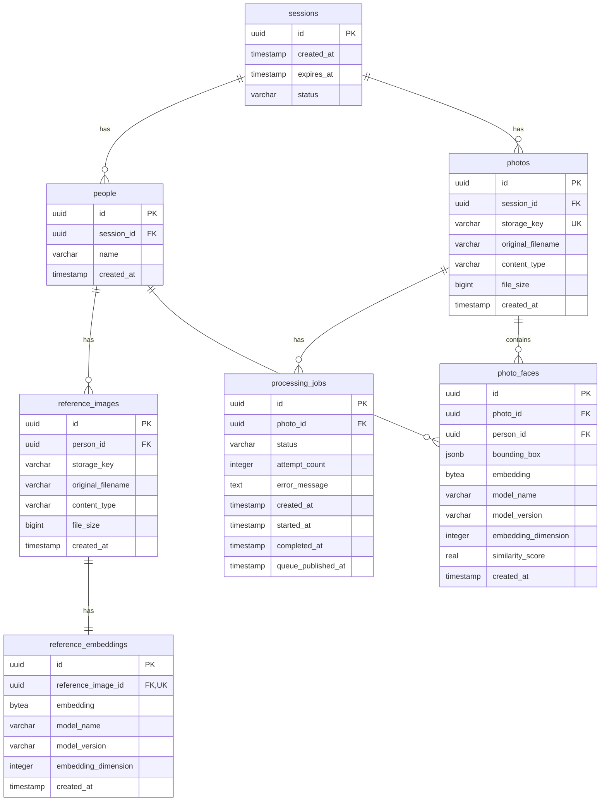

# Database Schema

WhoDis utilizes **PostgreSQL 18** managed through **Flyway** schema migrations. Entity mapping is provided by **Hibernate 6 / Spring Data JPA** with Hibernate `ddl-auto: validate` enabled to guarantee exact schema alignment.

---

## 1. Entity-Relationship Diagram

---

## 2. Table Specifications

### `sessions` (Migration: `V1__create_sessions.sql`)
Represents an ephemeral user session.

| Column | Type | Constraints | Description |
|---|---|---|---|
| `id` | `UUID` | `PRIMARY KEY` | Session unique identifier. |
| `created_at` | `TIMESTAMP WITH TIME ZONE` | `NOT NULL` | Session creation time. |
| `expires_at` | `TIMESTAMP WITH TIME ZONE` | `NOT NULL` | Instant after which the session is considered expired. |
| `status` | `VARCHAR(20)` | `NOT NULL` | Status enum: `ACTIVE`, `PROCESSING`, `COMPLETED`, `EXPIRED`. |

- **JPA Entity:** `com.whodis.backend.session.entity.Session`

---

### `people` (Migration: `V2__create_people.sql`)
Registered participant inside a session.

| Column | Type | Constraints | Description |
|---|---|---|---|
| `id` | `UUID` | `PRIMARY KEY` | Unique person identifier. |
| `session_id` | `UUID` | `NOT NULL`, `FK` -> `sessions(id)` ON DELETE CASCADE | Associated session. |
| `name` | `VARCHAR(100)` | `NOT NULL` | Person's display name. |
| `created_at` | `TIMESTAMP WITH TIME ZONE` | `NOT NULL` | Registration timestamp. |

- **Constraints & Indexes:**
  - `CONSTRAINT uq_people_session_name UNIQUE (session_id, name)`: Guarantees unique names per session.
  - `CONSTRAINT fk_people_session FOREIGN KEY (session_id) REFERENCES sessions(id) ON DELETE CASCADE`.
  - `CREATE INDEX idx_people_session_id ON people(session_id)`.
- **JPA Entity:** `com.whodis.backend.person.entity.Person`

---

### `reference_images` (Migration: `V3__create_reference_images.sql`)
Portrait reference photos uploaded for registered individuals.

| Column | Type | Constraints | Description |
|---|---|---|---|
| `id` | `UUID` | `PRIMARY KEY` | Unique image record ID. |
| `person_id` | `UUID` | `NOT NULL`, `FK` -> `people(id)` ON DELETE CASCADE | Associated person. |
| `storage_key` | `VARCHAR(255)` | `NOT NULL` | Relative filename on disk storage. |
| `original_filename` | `VARCHAR(255)` | `NOT NULL` | Filename uploaded by user. |
| `content_type` | `VARCHAR(100)` | `NOT NULL` | Verified MIME type (`image/jpeg`, etc.). |
| `file_size` | `BIGINT` | `NOT NULL` | Size in bytes. |
| `created_at` | `TIMESTAMP WITH TIME ZONE` | `NOT NULL` | Creation timestamp. |

- **Constraints & Indexes:**
  - `CONSTRAINT fk_reference_images_person FOREIGN KEY (person_id) REFERENCES people(id) ON DELETE CASCADE`.
  - `CREATE INDEX idx_reference_images_person_id ON reference_images(person_id)`.
- **JPA Entity:** `com.whodis.backend.referenceimage.entity.ReferenceImage`

---

### `reference_embeddings` (Migration: `V4__create_reference_embeddings.sql`)
512-dimensional vector embedding extracted from a reference portrait.

| Column | Type | Constraints | Description |
|---|---|---|---|
| `id` | `UUID` | `PRIMARY KEY` | Embedding unique identifier. |
| `reference_image_id` | `UUID` | `NOT NULL`, `UK`, `FK` -> `reference_images(id)` ON DELETE CASCADE | 1-to-1 relationship with `reference_images`. |
| `embedding` | `BYTEA` | `NOT NULL` | 512 `float32` values encoded in little-endian binary (2,048 bytes). |
| `model_name` | `VARCHAR(100)` | `NOT NULL` | E.g. `buffalo_l`. |
| `model_version` | `VARCHAR(50)` | `NOT NULL` | E.g. `2.0`. |
| `embedding_dimension` | `INTEGER` | `NOT NULL` | Fixed dimension: `512`. |
| `created_at` | `TIMESTAMP WITH TIME ZONE` | `NOT NULL` | Timestamp. |

- **Constraints & Indexes:**
  - `CONSTRAINT uq_reference_embeddings_reference_image UNIQUE (reference_image_id)`.
  - `CONSTRAINT fk_reference_embeddings_reference_image FOREIGN KEY (reference_image_id) REFERENCES reference_images(id) ON DELETE CASCADE`.
  - `CREATE INDEX idx_reference_embeddings_reference_image_id ON reference_embeddings(reference_image_id)`.
- **JPA Entity:** `com.whodis.backend.referenceimage.entity.ReferenceEmbedding`

---

### `photos` (Migrations: `V5__create_photos.sql`, `V6__add_unique_storage_key_to_photos.sql`)
Group photos uploaded to a session.

| Column | Type | Constraints | Description |
|---|---|---|---|
| `id` | `UUID` | `PRIMARY KEY` | Unique photo ID. |
| `session_id` | `UUID` | `NOT NULL`, `FK` -> `sessions(id)` ON DELETE CASCADE | Associated session. |
| `storage_key` | `VARCHAR(255)` | `NOT NULL`, `UNIQUE` | Unique file storage path. |
| `original_filename` | `VARCHAR(255)` | `NOT NULL` | Uploaded filename. |
| `content_type` | `VARCHAR(100)` | `NOT NULL` | Verified MIME type. |
| `file_size` | `BIGINT` | `NOT NULL` | Size in bytes. |
| `created_at` | `TIMESTAMP WITH TIME ZONE` | `NOT NULL` | Upload timestamp. |

- **Constraints & Indexes:**
  - `CONSTRAINT uq_photos_storage_key UNIQUE (storage_key)` (added in V6).
  - `CONSTRAINT fk_photos_session FOREIGN KEY (session_id) REFERENCES sessions(id) ON DELETE CASCADE`.
  - `CREATE INDEX idx_photos_session_id ON photos(session_id)`.
- **JPA Entity:** `com.whodis.backend.photo.entity.Photo`

---

### `processing_jobs` (Migrations: `V7__create_processing_jobs.sql`, `V9__add_queue_published_at_to_processing_jobs.sql`)
Asynchronous execution tracking for photos.

| Column | Type | Constraints | Description |
|---|---|---|---|
| `id` | `UUID` | `PRIMARY KEY` | Job identifier. |
| `photo_id` | `UUID` | `NOT NULL`, `FK` -> `photos(id)` ON DELETE CASCADE | Target photo. |
| `status` | `VARCHAR(20)` | `NOT NULL` | `PENDING`, `PROCESSING`, `COMPLETED`, `FAILED`. |
| `attempt_count` | `INTEGER` | `NOT NULL DEFAULT 0` | Retry counter. |
| `error_message` | `TEXT` | `NULL` | Truncated error message if execution failed. |
| `created_at` | `TIMESTAMP WITH TIME ZONE` | `NOT NULL` | Job creation time. |
| `started_at` | `TIMESTAMP WITH TIME ZONE` | `NULL` | Timestamp when worker claimed the job. |
| `completed_at` | `TIMESTAMP WITH TIME ZONE` | `NULL` | Timestamp of completion or failure. |
| `queue_published_at` | `TIMESTAMP WITH TIME ZONE` | `NULL` | Timestamp when published to Redis Streams. |

- **Constraints & Indexes:**
  - `CONSTRAINT chk_processing_jobs_attempt_count CHECK (attempt_count >= 0)`.
  - `CONSTRAINT chk_processing_jobs_status CHECK (status IN ('PENDING', 'PROCESSING', 'COMPLETED', 'FAILED'))`.
  - `CREATE INDEX idx_processing_jobs_status_created_at ON processing_jobs(status, created_at)`.
  - `CREATE INDEX idx_processing_jobs_photo_id ON processing_jobs(photo_id)`.
- **JPA Entity:** `com.whodis.backend.processingjob.entity.ProcessingJob`

---

### `photo_faces` (Migration: `V8__create_photo_faces.sql`)
Faces detected in a group photo, optionally matched to a person.

| Column | Type | Constraints | Description |
|---|---|---|---|
| `id` | `UUID` | `PRIMARY KEY` | Detected face unique ID. |
| `photo_id` | `UUID` | `NOT NULL`, `FK` -> `photos(id)` ON DELETE CASCADE | Photo containing the face. |
| `person_id` | `UUID` | `NULL`, `FK` -> `people(id)` ON DELETE CASCADE | Matched person (or `NULL` if unrecognized). |
| `bounding_box` | `JSONB` | `NOT NULL` | Coordinates: `{"x1":..., "y1":..., "x2":..., "y2":...}`. |
| `embedding` | `BYTEA` | `NOT NULL` | Little-endian binary encoded 512 float32 embedding. |
| `model_name` | `VARCHAR(100)` | `NOT NULL` | Model name (`buffalo_l`). |
| `model_version` | `VARCHAR(50)` | `NOT NULL` | Model version (`2.0`). |
| `embedding_dimension` | `INTEGER` | `NOT NULL` | Fixed dimension (512). |
| `similarity_score` | `REAL` | `NULL` | Cosine similarity score $[0.0, 1.0]$. |
| `created_at` | `TIMESTAMP WITH TIME ZONE` | `NOT NULL` | Timestamp. |

- **Constraints & Indexes:**
  - `CONSTRAINT fk_photo_faces_photo FOREIGN KEY (photo_id) REFERENCES photos(id) ON DELETE CASCADE`.
  - `CONSTRAINT fk_photo_faces_person FOREIGN KEY (person_id) REFERENCES people(id) ON DELETE CASCADE`.
  - `CONSTRAINT chk_photo_faces_embedding_dimension CHECK (embedding_dimension = 512)`.
  - `CONSTRAINT chk_photo_faces_similarity_score CHECK (similarity_score IS NULL OR (similarity_score >= 0 AND similarity_score <= 1))`.
  - `CREATE INDEX idx_photo_faces_photo_id ON photo_faces(photo_id)`.
  - `CREATE INDEX idx_photo_faces_person_id ON photo_faces(person_id)`.
- **JPA Entity:** `com.whodis.backend.photoface.entity.PhotoFace`

---

## 3. Flyway Migrations vs. JPA Entities: Discrepancy Analysis

A rigorous cross-check between Flyway migration DDL and JPA `@Entity` definitions reveals the following:

1. **Foreign Key Cascade Deletion:**
   - In Flyway migrations (`V2` through `V8`), foreign keys are defined with `ON DELETE CASCADE` (e.g. deleting a photo cascades deletion to `photo_faces` and `processing_jobs` at the database level).
   - In JPA entity relationships, cascades are not declared (`@ManyToOne` does not specify `cascade = CascadeType.REMOVE`). Instead, services (`SessionCleanupService`, `PhotoDeletionService`) explicitly execute bulk JPQL delete queries (`photoFaceRepository.deleteAllByPhotoId()`, `processingJobRepository.deleteAllByPhotoId()`) in proper relational order. This design avoids unintended Hibernate cascading while retaining relational safety.
2. **PostgreSQL JSONB Type Handling:**
   - In `photo_faces`, `bounding_box` is defined as `JSONB` in Flyway (`V8`).
   - In JPA, `PhotoFace` maps this field using `@JdbcTypeCode(SqlTypes.JSON)` and stores a JSON `String`. This matches Hibernate 6 specifications for PostgreSQL JSONB columns.
3. **Database Check Constraints:**
   - Database migrations define table check constraints (`chk_processing_jobs_status`, `chk_processing_jobs_attempt_count`, `chk_photo_faces_embedding_dimension`, `chk_photo_faces_similarity_score`). These are not declared as Hibernate annotations but are fully enforced by PostgreSQL upon insert/update.
4. **Queue Published Column:**
   - Flyway migration `V9__add_queue_published_at_to_processing_jobs.sql` added `queue_published_at TIMESTAMP WITH TIME ZONE`. The entity `ProcessingJob` correctly includes `private Instant queuePublishedAt;`.
