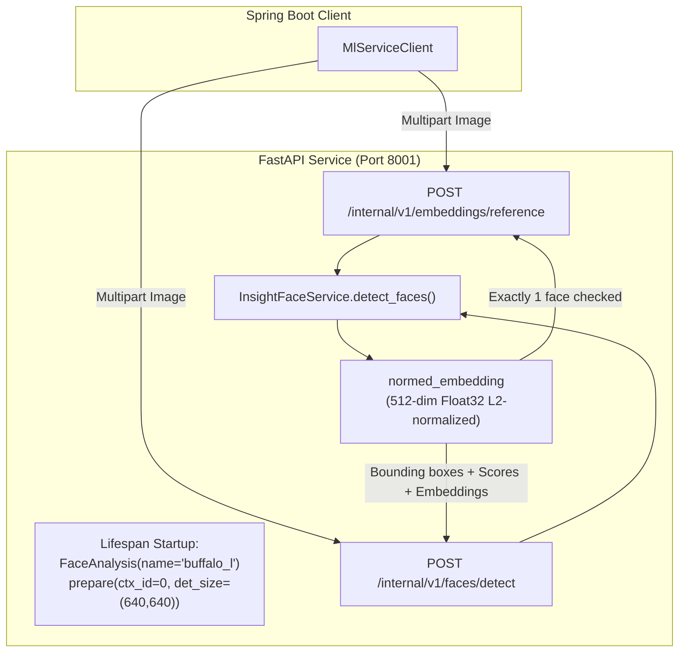
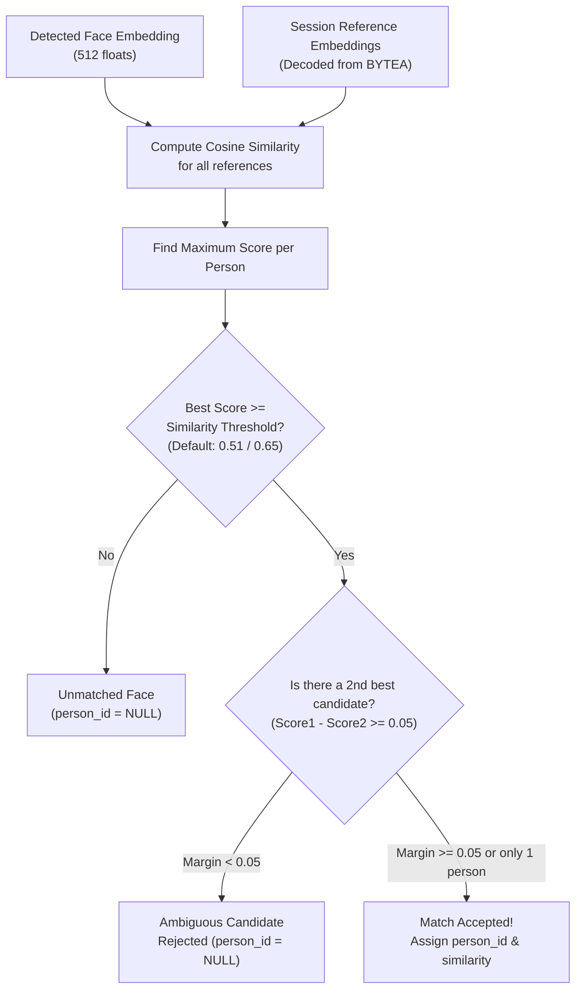

# Machine Learning Pipeline

The WhoDis ML service is an inference engine built on **FastAPI** and **InsightFace**. It performs face detection, alignment, feature extraction, and facial embedding generation. Vector matching and similarity thresholding are executed on the Spring Boot backend using cosine similarity.

---

## 1. Service Architecture & Dependencies

- **Framework:** FastAPI with Uvicorn ASGI server.
- **Model Framework:** InsightFace >= 2.0 with ONNX Runtime backend (`onnxruntime-gpu==1.30.0` with fallback to `CPUExecutionProvider`).
- **Model Package:** `buffalo_l` (InsightFace model pack, version reported as `2.0`).
- **Execution Providers:** `CUDAExecutionProvider` prioritized, falling back to `CPUExecutionProvider`.
- **Image Decoding:** OpenCV (`cv2.imdecode`) in BGR format.
- **Lifecycle Management:** FastAPI `lifespan` handler initializes `InsightFaceService` once on application startup, preparing the model with detection size $640 \times 640$.



---

## 2. Model Specifications & Face Detection

### Model Suite Details
- **Suite Name:** `buffalo_l`
- **Reported Model Version:** `2.0`
- **Detection Resolution:** Configured to `det_size=(640, 640)`
- **Embedding Dimension:** `512` floating-point numbers per face (`float32`)
- **Embedding Property:** L2-normalized unit vectors (`face.normed_embedding`). Because vectors are L2-normalized ($\|u\|_2 = 1$), the cosine similarity between two embeddings simplifies to their dot product:
  $$\text{sim}(u, v) = u \cdot v = \sum_{i=1}^{512} u_i v_i$$

### Detection & Extraction Process
1. **Multipart Upload:** Image bytes are received via HTTP multipart form (`file` parameter).
2. **Buffer Decoding:** Raw bytes are decoded using OpenCV:
   ```python
   image_array = np.frombuffer(image_bytes, dtype=np.uint8)
   image = cv2.imdecode(image_array, cv2.IMREAD_COLOR)
   ```
3. **Face Analysis:** `app.get(image)` runs detection and recognition networks:
   - Identifies bounding boxes (`face.bbox`: $[x_1, y_1, x_2, y_2]$).
   - Computes detection confidence score (`face.det_score`: $0.0 \le \text{score} \le 1.0$).
   - Computes normalized embedding vector (`face.normed_embedding`: 512 dimensions).

---

## 3. Endpoints Exposed by the ML Service

### 1. Reference Image Embedding Extraction
Extracts embedding for a reference portrait.

- **Method:** `POST`
- **URL:** `/internal/v1/embeddings/reference`
- **Request:** Multipart form data with field `file`.
- **Validation & Business Logic:**
  - If image buffer is empty or unparseable: Returns `HTTP 400 Bad Request` (`"Invalid image"`).
  - If 0 faces detected: Raises `ValueError("No face detected")` -> Returns `HTTP 422 Unprocessable Entity`.
  - If >1 faces detected: Raises `ValueError("Reference image must contain exactly one face")` -> Returns `HTTP 422 Unprocessable Entity`.
- **Response Status:** `200 OK`
- **Response JSON Example:**
```json
{
  "embedding": [
    0.0412354,
    -0.0184521,
    0.0934125,
    "..."
  ],
  "model": "buffalo_l",
  "model_version": "2.0",
  "dimension": 512
}
```

### 2. Group Photo Face Detection
Detects all faces in a group photo.

- **Method:** `POST`
- **URL:** `/internal/v1/faces/detect`
- **Request:** Multipart form data with field `file`.
- **Validation & Business Logic:**
  - If image buffer is unparseable: Returns `HTTP 400 Bad Request` (`"Invalid image"`).
  - If no faces are detected: Returns `HTTP 200 OK` with an empty `faces` array (`[]`).
  - Internal exceptions: Returns `HTTP 500 Internal Server Error` (`"Face detection failed"`).
- **Response Status:** `200 OK`
- **Response JSON Example:**
```json
{
  "model": "buffalo_l",
  "model_version": "2.0",
  "dimension": 512,
  "faces": [
    {
      "bounding_box": {
        "x1": 152.4,
        "y1": 84.6,
        "x2": 298.2,
        "y2": 275.1
      },
      "det_score": 0.9421,
      "embedding": [
        0.0412354,
        -0.0184521,
        0.0934125,
        "..."
      ]
    }
  ]
}
```

### 3. Health Check
- **Method:** `GET`
- **URL:** `/health`
- **Response:** `{"status": "ok"}`

---

## 4. Backend Face Matching & Recognition Logic

While feature extraction happens in Python, matching against registered participants is executed in Spring Boot by `com.whodis.backend.ml.service.FaceMatchingService`.



### Matching Algorithm & Thresholds

1. **Embedding Decoding:** Reference embeddings stored in PostgreSQL as `BYTEA` are converted back to `float[]` via `EmbeddingCodec.decode()`.
2. **Cosine Similarity Calculation:**
   $$\text{similarity} = \frac{\sum_{i=0}^{511} A_i B_i}{\sqrt{\sum_{i=0}^{511} A_i^2} \cdot \sqrt{\sum_{i=0}^{511} B_i^2}}$$
3. **Score Aggregation per Person:** A person may have multiple reference images. The candidate score for a person is:
   $$\text{score}(\text{person}) = \max_{\text{ref} \in \text{person}} \text{similarity}(\text{detected}, \text{ref})$$
4. **Rank Ordering:** Candidates are sorted descending by score: $[\text{candidate}_1, \text{candidate}_2, \dots]$.
5. **Similarity Threshold Verification:**
   - Candidate 1 must meet or exceed the similarity threshold:
     $$\text{score}_1 \ge \text{threshold}$$
   - **Configured Thresholds:**
     - `application.yaml`: `whodis.face-matching.similarity-threshold: 0.51`
     - Code default fallback in `@Value`: `0.65`
6. **Minimum Margin Rule (Disambiguation):**
   - If more than one person has reference embeddings, the difference between the top candidate and the runner-up must satisfy:
     $$\text{margin} = \text{score}_1 - \text{score}_2 \ge \text{minimumMargin}$$
   - **Configured Margin:** `whodis.face-matching.minimum-margin: 0.05`
   - If the margin is less than `0.05`, the face is deemed ambiguous and left unmatched (`person_id = NULL`).
