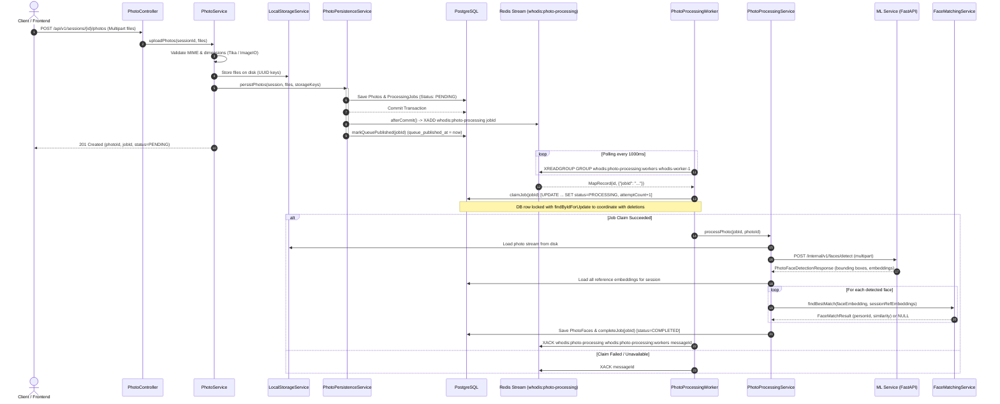
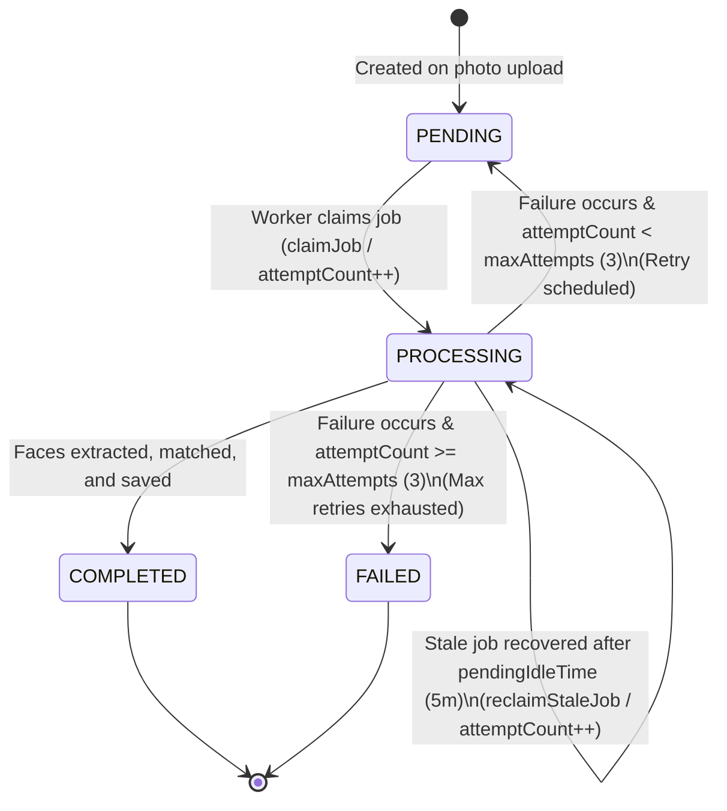
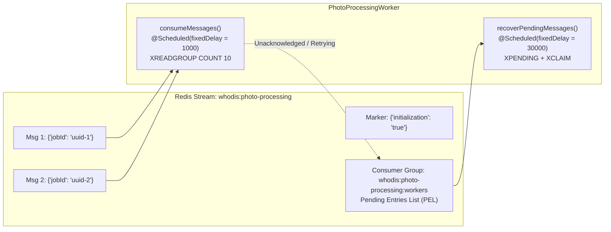

# Asynchronous Processing Pipeline

WhoDis uses an asynchronous, resilient processing pipeline to handle heavy image processing and computer vision workloads. Group photos are uploaded, stored, and queued into **Redis Streams**, while a scheduled background worker claims jobs, invokes the ML service, evaluates facial similarity against registered references, and updates the database.

---

## 1. End-to-End Processing Workflow



---

## 2. Processing Job State Machine

Each photo upload instantiates a `ProcessingJob` tracked in PostgreSQL:



### State Transitions & Persistence Rules
1. **PENDING:** Initial state upon upload. `attempt_count = 0`, `started_at = NULL`, `completed_at = NULL`.
2. **PROCESSING:** When a worker picks up the job via `claimJob(jobId)`. Executes an atomic conditional update:
   ```sql
   UPDATE ProcessingJob j
   SET j.status = 'PROCESSING',
       j.attemptCount = j.attemptCount + 1,
       j.startedAt = :now,
       j.errorMessage = null
   WHERE j.id = :jobId AND j.status = 'PENDING'
   ```
3. **COMPLETED:** All faces are detected, matched, persisted in `photo_faces`, and `ProcessingJobService.completeJob(jobId)` sets `status = COMPLETED`, `completed_at = Instant.now()`.
4. **RETRY (to PENDING):** If an exception occurs and `attempt_count < 3`:
   ```sql
   UPDATE ProcessingJob j
   SET j.status = 'PENDING',
       j.startedAt = null,
       j.completedAt = null,
       j.errorMessage = :errorMessage
   WHERE j.id = :jobId
     AND j.status = 'PROCESSING'
     AND j.attemptCount < :maxAttempts
   ```
   *Notice:* The Redis stream message is **not** acknowledged (`XACK`), remaining in the Pending Entries List (PEL) for subsequent recovery.
5. **FAILED:** If an exception occurs and `attempt_count >= 3`, `failJob(jobId, errorMessage)` marks `status = FAILED`, `completed_at = Instant.now()`, and the message is acknowledged with `XACK`.

---

## 3. Redis Streams Message Flow & Group Architecture



### Stream & Group Initialization
- **Configuration Class:** `PhotoProcessingStreamConfig` implements `InitializingBean`.
- **Stream Key:** `whodis:photo-processing`
- **Consumer Group:** `whodis:photo-processing:workers`
- **Consumer Name:** `whodis-worker-1`
- **Initialization Logic:**
  - If the stream key does not exist, an initialization entry `Map.of("initialization", "true")` is written via `opsForStream().add()`.
  - The consumer group is created starting from ID `"0"` (`ReadOffset.from("0")`).
  - If the group already exists (`BUSYGROUP` exception), the error is caught and logged.

---

## 4. Resilience, Idempotency & Fault Tolerance

### Stale Job Recovery (`recoverPendingMessages`)
- **Trigger:** Runs every 30,000 ms (`whodis.processing.worker.recovery-interval: 30000`).
- **Idle Cutoff:** Configured to 5 minutes in `application.yaml` (`pending-idle-time: 5m`, fallback `60s`).
- **Mechanism:**
  1. Inspects the Redis PEL using `redisTemplate.opsForStream().pending(...)` for messages idle longer than `pendingIdleTime`.
  2. Claims ownership using `redisTemplate.opsForStream().claim(...)`.
  3. Reclaims the job in PostgreSQL via `reclaimStaleJob(jobId, idleTimeout)`:
     ```sql
     UPDATE ProcessingJob j
     SET j.startedAt = :now,
         j.attemptCount = j.attemptCount + 1,
         j.errorMessage = null
     WHERE j.id = :jobId
       AND j.status = 'PROCESSING'
       AND j.startedAt <= :cutoff
     ```
  4. If the job in PostgreSQL was already `COMPLETED` or `FAILED`, the message is immediately acknowledged (`XACK`) to clean up Redis.

### Queue Reconciliation (`PhotoQueueReconciliationService`)
- **Trigger:** Runs every 30,000 ms (`whodis.processing.worker.reconciliation-interval: 30s`).
- **Problem Solved:** Guarantees delivery when Redis was unavailable at the time a transaction committed.
- **Mechanism:**
  - Queries `findTop50ByStatusAndQueuePublishedAtIsNullOrderByCreatedAtAsc(PENDING)`.
  - For each job, invokes `photoProcessingQueue.publish(jobId)` and updates `queue_published_at = Instant.now()`.

### Concurrency & Idempotency Safeguards
1. **Photo Deletion Lock:** When deleting a photo, `PhotoDeletionService` queries `processingJobRepository.existsByPhotoIdAndStatus(photoId, PROCESSING)`. If active, deletion is rejected with `HTTP 409 Conflict`.
2. **Atomic Job Claiming:** Multiple concurrent workers cannot process the same job because `claimJob` checks `status = 'PENDING'` atomically. Only 1 row is updated.
3. **Idempotent Face Persistence:** `PhotoFacePersistenceService.saveFacesAndCompleteJob()` first executes `photoFaceRepository.deleteAllByPhotoId(photoId)` before inserting newly detected faces, ensuring clean replacement if a job was reprocessed.
4. **Zero-Face Handling:** If a photo contains zero faces, the ML service returns an empty face list (`faces: []`). The backend processes this without error, saves zero `PhotoFace` records, and marks the job as `COMPLETED`.
